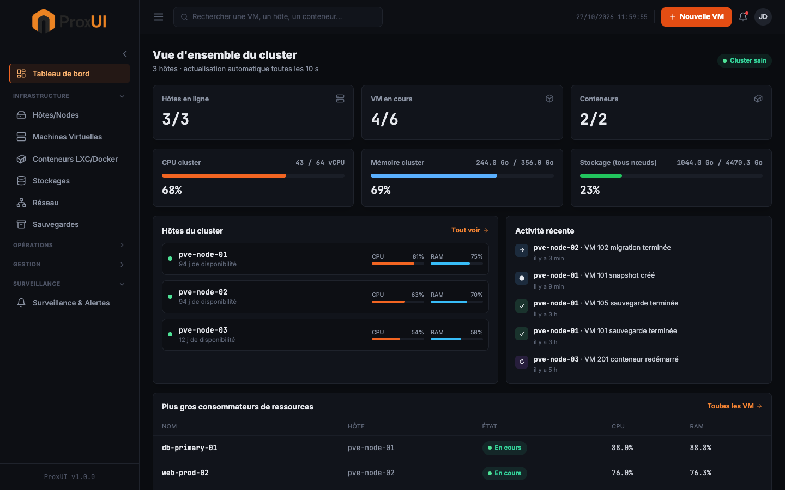
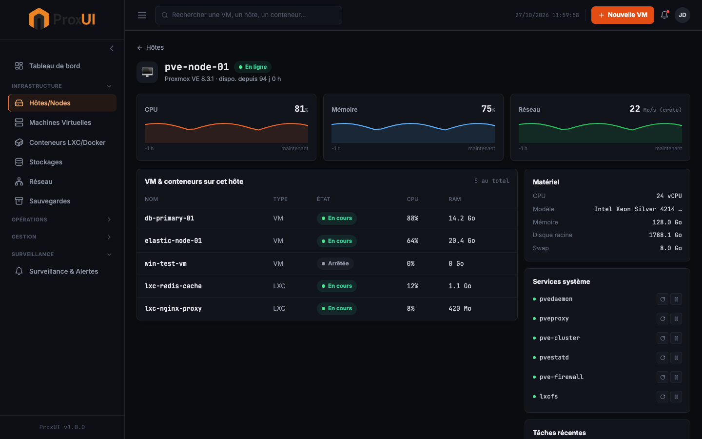
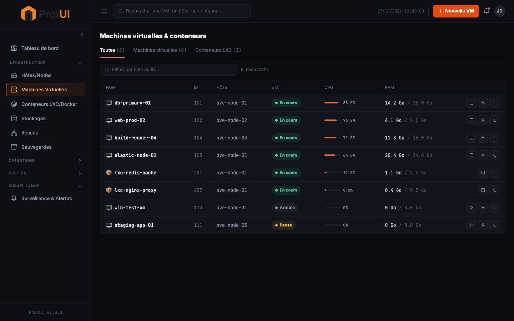
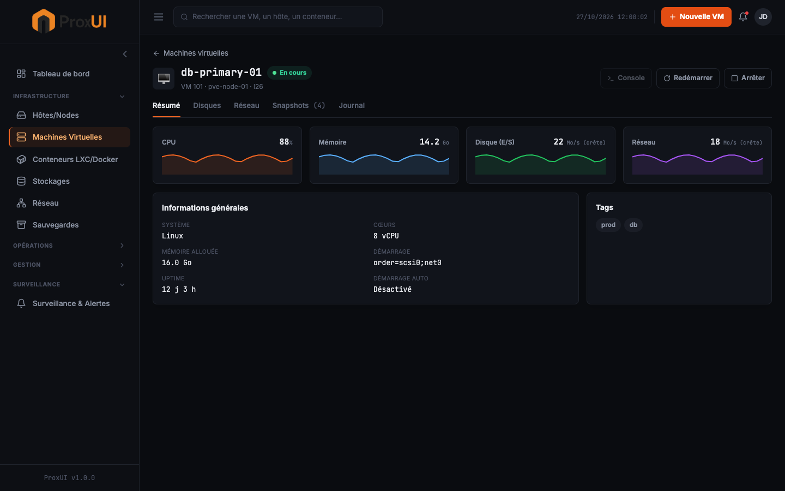

# ProxUI

[](https://github.com/Eizi0/proxui/actions/workflows/ci.yml)
[](./LICENSE)
[](https://github.com/Eizi0/proxui/releases)

Interface web pour gérer Proxmox VE — React/Vite + Tailwind en frontend, Express en backend qui relaie l'API Proxmox réelle. Pensée pour se rapprocher, à terme, de la richesse fonctionnelle d'outils matures comme Xen Orchestra : tableaux de bord à chaque niveau (cluster, hôte, VM), pas seulement une liste de machines.

## Captures d'écran

| Tableau de bord | Détail d'un hôte |
|---|---|
|  |  |

| Liste des VM/conteneurs | Détail d'une VM (à onglets) |
|---|---|
|  |  |

## Fonctionnalités

- **Tableau de bord cluster** — état des hôtes, jauges CPU/mémoire/stockage agrégées sur tout le cluster, activité récente, plus gros consommateurs de ressources.
- **Détail d'un hôte** — graphiques de ressources (CPU/mémoire/réseau, données RRD réelles), matériel, services système avec contrôle démarrer/arrêter/redémarrer, VM/conteneurs hébergés.
- **Liste des VM et conteneurs LXC** — table filtrable multi-nœuds, actions rapides (démarrer/arrêter, éditer, détail), tags.
- **Détail d'une VM** à onglets — Résumé (graphiques RRD par VM), Disques, Réseau, Snapshots (lecture + création), Journal des tâches.
- **Gestion Docker** sur l'hôte, séparée de la gestion LXC.
- **Mode démonstration** (`DEMO_MODE=true`) — lance l'interface avec des données réalistes (3 nœuds, VM, LXC, tâches, snapshots) sans avoir besoin d'un cluster Proxmox pour l'essayer.

D'autres pages existent dans le code (déploiement de VM/conteneur, téléchargement d'ISO/templates, migration, planification de sauvegardes, réseau, stockage, paramètres) mais n'ont pas encore reçu la même passe de refonte visuelle que les quatre écrans ci-dessus.

## Stack technique

**Backend** : Node.js, Express, axios (client API Proxmox), Dockerode (Docker), WebSocket.
**Frontend** : React 18, Vite, Tailwind CSS, React Router, Lucide Icons.
**Tests** : Vitest + Supertest (contre l'app Express réelle, en mode démo — voir [Tests](#tests)).
**CI** : GitHub Actions, tests + build à chaque push/PR sur `main`.

## Démarrage rapide (mode démo, sans cluster Proxmox)

```bash
git clone https://github.com/Eizi0/proxui.git
cd proxui
npm install
DEMO_MODE=true npm run dev

# Backend : http://localhost:3000
# Frontend : http://localhost:5173
```

## Démarrage avec un vrai cluster Proxmox

```bash
git clone https://github.com/Eizi0/proxui.git
cd proxui
npm install
cp .env.example .env   # renseigner PROXMOX_HOST, PROXMOX_USER, PROXMOX_PASSWORD
npm run dev
```

### Configuration (`.env`)

```env
PROXMOX_HOST=https://192.168.1.100:8006
PROXMOX_USER=root@pam
PROXMOX_PASSWORD=votre_mot_de_passe
PROXMOX_NODE=pve
PROXMOX_VERIFY_SSL=false

PORT=3000
NODE_ENV=production

DOCKER_SOCKET=/var/run/docker.sock
```

### Déploiement en production

```bash
npm run build
NODE_ENV=production npm start
```

Un `Dockerfile` et un `docker-compose.yml` sont fournis pour un déploiement en conteneur.

## Tests

```bash
npm test
```

17 tests (Vitest + Supertest), exécutés contre l'app Express réelle en mode démo, pas des mocks du routeur. Ils couvrent en particulier les régressions de bugs réels déjà trouvés et corrigés dans ce dépôt : agrégation multi-nœuds des VM/LXC, filtre `?type=` sur `/api/proxmox/resources`, et prise en compte du nœud réel d'une VM sur les routes `/vms/:vmid/*`.

## Structure du projet

```
proxui/
├── server/
│   ├── index.js               # Point d'entrée Express (exporte `app`, teste-able)
│   ├── routes/                # proxmox.js, docker.js, stats.js, snapshots.js, config.js...
│   ├── services/
│   │   ├── proxmoxAPI.js      # Client API Proxmox (ticket d'auth, requêtes)
│   │   ├── dockerAPI.js
│   │   └── demoData.js        # Fixtures du mode démo
│   └── *.test.js              # Tests Vitest + Supertest, à côté du code qu'ils couvrent
├── src/
│   ├── components/
│   │   ├── ui/                # StatusPill, Sparkline — composants réutilisables
│   │   ├── Sidebar.jsx, Header.jsx, Layout.jsx
│   │   └── EditVMModal.jsx
│   ├── pages/                 # Dashboard, HostDetails, VMs, VMDetail, Settings...
│   └── App.jsx
├── docs/screenshots/
├── .github/workflows/ci.yml
├── Dockerfile, docker-compose.yml
└── package.json
```

## Points d'API principaux

### Proxmox

- `GET /api/proxmox/nodes` — liste des nœuds
- `GET /api/proxmox/resources?type=&node=` — vue cluster, filtrable par type (`qemu`/`lxc`/`node`) et par nœud
- `GET /api/proxmox/vms/:vmid?node=` — statut d'une VM (le nœud est requis sur un cluster à plusieurs nœuds)
- `POST /api/proxmox/vms/:vmid/{start,stop,shutdown,reboot}?node=`
- `GET /api/proxmox/vms/:vmid/{config,interfaces,rrddata}?node=`
- Équivalents `GET/POST /api/proxmox/lxc/...` pour les conteneurs LXC

### Statistiques (agrégées sur tout le cluster)

- `GET /api/stats/overview` — vue d'ensemble (hôtes, VM, LXC, Docker)
- `GET /api/stats/recent-resources?limit=` — VM/LXC triés par utilisation CPU
- `GET /api/stats/activity?limit=` — journal de tâches fusionné sur tous les nœuds

### Snapshots

- `GET/POST /api/snapshots/:type/:vmid?node=` (`type` = `qemu` ou `lxc`)
- `POST /api/snapshots/:type/:vmid/:snapname/rollback?node=`

### Docker

- `GET /api/docker/containers`, `POST .../start`, `.../stop`, `.../restart`, `DELETE .../:id`

## Sécurité

- Ne jamais committer le fichier `.env`.
- Utiliser un compte/token API Proxmox avec des permissions limitées plutôt que `root@pam`.
- Activer HTTPS et passer par un reverse proxy (nginx/Traefik) en production.
- Restreindre l'accès au socket Docker si la gestion Docker est activée.

## Reste à faire

- Authentification multi-utilisateurs
- Console intégrée (VNC/SPICE) — le bouton existe dans le détail VM, pas encore branché
- Backup/restore complet au-delà des snapshots
- Support explicite multi-cluster Proxmox

## Licence

MIT — voir [LICENSE](./LICENSE).
